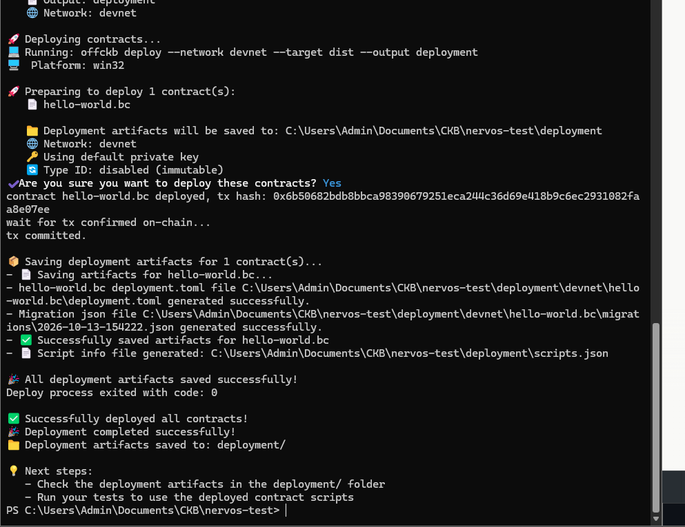

## Builder Track Weekly Report — Week 1

**Name:** @Calvith (Telegram)  
**Week Ending:** 10-19-2026

### Courses Completed

- Read the CKB intro docs: [Nervos CKB](https://docs.nervos.org/docs/ckb-fundamentals/nervos-blockchain), [How CKB Works](https://docs.nervos.org/docs/getting-started/how-ckb-works), [Quick Start](https://docs.nervos.org/docs/getting-started/quick-start), [Intro to Script](https://docs.nervos.org/docs/script/intro-to-script)
- [CKB Academy](https://academy.ckb.dev/courses): **CKB Basic Theoretical Knowledge**, covering cells, transactions, and lock/type scripts

### Key Learnings

- The **cell model**: transactions consume live cells and create new ones, and 1 CKB = 1 byte of storage
- **Scripts**: `code_hash`, `hash_type` and `args`. The lock script controls ownership, and the type script sets the rules
- Deploying a contract stores its binary in a cell, which other scripts reference through `cell_deps`

### Practical Progress

- **Set up a local devnet** with OffCKB
- **Deployed a hello-world contract** to devnet (tx `0x6b50682b…a8e07ee`)
- Created 3 testnet wallets, claimed test CKB from the faucet, and **transferred between them** ([tx 1](https://testnet.explorer.nervos.org/transaction/0x5d350f9197653591f25ea7e54976f7b281665ffa0ac25fc19c7d83bd24d59384), [tx 2](https://testnet.explorer.nervos.org/transaction/0x164a4f6d5d0171b120917eeba2de6b448a21955735364195a7c995fb6bee2560), [tx 3](https://testnet.explorer.nervos.org/transaction/0xd920681fd5c608fb1011d766f5d1d432b8a6bfa33824e2ed7444b4cf7fbc7981))
- Set up a **CKBull** mainnet wallet

### Environment

- Node.js v22, OffCKB and CCC installed
- Local devnet working, and basic debugging started (port conflict, pending-tx double spend)
