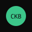

## Builder Track Weekly Report — Week 2

**Name:** @Calvith (Telegram)  
**Week Ending:** 10-26-2026

### Courses Completed

- Completed all 5 CKB **Beginner dApp tutorials** on **testnet**:
  - [Transfer CKB](https://docs.nervos.org/docs/dapp/transfer-ckb)
  - [Store Data on Cell](https://docs.nervos.org/docs/dapp/store-data-on-cell)
  - [Create Fungible Token](https://docs.nervos.org/docs/dapp/create-token)
  - [Create DOB](https://docs.nervos.org/docs/dapp/create-dob)
  - [Build a Simple Lock](https://docs.nervos.org/docs/dapp/simple-lock)

### Key Learnings

- A cell's data can hold anything. Capacity = 61 CKB base + 1 CKB per byte, so a 56-byte message took a 117 CKB cell
- **xUDT**: the token ID is the issuer's lock hash + `00000000`, and the amount is a 16-byte little-endian number in data
- **Spore DOB**: the content (here, an image) is stored fully on-chain and immutably
- A **lock script** is just code that returns 0. The hash lock checks a preimage in the witness, with no signature, which is why real locks need signatures

### Practical Progress

- **Stored a message** on-chain and read it back ([tx](https://testnet.explorer.nervos.org/transaction/0xead15fe330d4f7acf3d7eecb34e9876cf2c875b274f6c514a4059d47961eff84))
- **Issued an xUDT token** (1,000,000 units) ([tx](https://testnet.explorer.nervos.org/transaction/0x3ac28e2d41fb9602bfb58dff0e31d790649e95fea719dd4aebf399e0603d9546)) and **transferred 250,000** to a second wallet ([tx](https://testnet.explorer.nervos.org/transaction/0xc072530e35dea4bab4cb2aa6f915d2be89e9e74d22be785b3b9d44af5df34d21))
- **Minted a Spore DOB** with an SVG image ([tx](https://testnet.explorer.nervos.org/transaction/0x481b9331790113015436e4277fa64defe5a04a8191811507fce983d88e7e865d)), then read it back from chain byte-for-byte
- **Built and deployed the hash-lock script** to testnet ([deploy tx](https://testnet.explorer.nervos.org/transaction/0xa908a9e1a0b2db0bb0ffff3fa06059996036eb723f98502af80a73d2d5f05865)) and funded it with 300 CKB ([tx](https://testnet.explorer.nervos.org/transaction/0x36a4215cce1000fc5fb5df0afe7fbecc9af1730a76de1febed2be30e879b376a)):
  - A wrong preimage was rejected with error code 11
  - The correct preimage unlocked it ([tx](https://testnet.explorer.nervos.org/transaction/0x5fed1e64c834da139a53ffa9456d60ee70272afc259f78ea940b05a14a98913a))

### Environment

- CCC (`@ckb-ccc/shell`) scripts against the public testnet; ckb-debugger and pnpm installed
- Fixed a Windows build issue: the tutorial's `./node_modules/.bin/esbuild` path fails in cmd, so I ran the esbuild and ckb-debugger steps manually
